# Практическая работа № 1 — Базовое администрирование Linux

**Тема:** управление пользователями и вход по SSH-ключу.  
**Дисциплина:** DevOps.  
**Среда:** Oracle VirtualBox, Ubuntu 24.04.1 LTS, Windows (хостовая система).

## Цель работы

Освоить базовые команды администрирования Linux, настроить сетевой доступ к виртуальной машине, установить SSH-сервер, создать отдельного пользователя, разрешить вход по SSH-ключу с Windows и подключиться к Ubuntu с помощью Visual Studio Code Remote - SSH.

## Используемое окружение

| Параметр | Значение |
|---|---|
| Гостевая ОС | Ubuntu 24.04.1 LTS |
| Ядро Linux | `6.14.0-37-generic` |
| Виртуализация | Oracle VirtualBox |
| Сеть ВМ | NAT, интерфейс `enp0s3` |
| IP гостевой системы | `10.0.2.15` |
| Проброс SSH | `127.0.0.1:2222` (Windows) → `10.0.2.15:22` (Ubuntu) |
| Учебный пользователь | `runner`, домашний каталог `/home/runner` |
| SSH-ключ | Ed25519, создан в Windows; в Ubuntu передан только публичный ключ |
| Python | `3.12.3` |
| Git | `2.43.0` |

## Ход выполнения

### 1. Проверка системы и сетевого подключения

В VirtualBox используется Ubuntu 24.04.1 LTS. Выполнены команды определения версии ОС и настройки сети:

```bash
lsb_release -a
ip addr
ping -c 4 google.com
```

Интерфейс `enp0s3` имеет адрес `10.0.2.15`. Проверка `ping` показала **4 полученных пакета из 4, потерь 0%**.

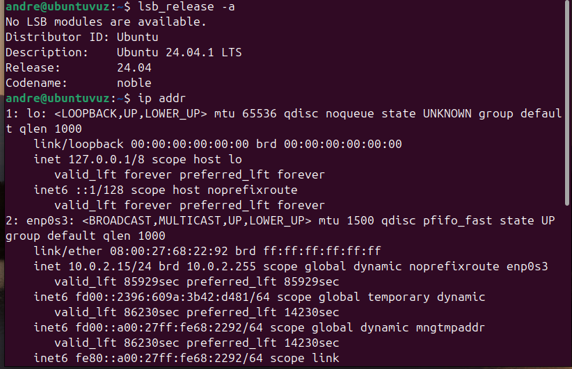

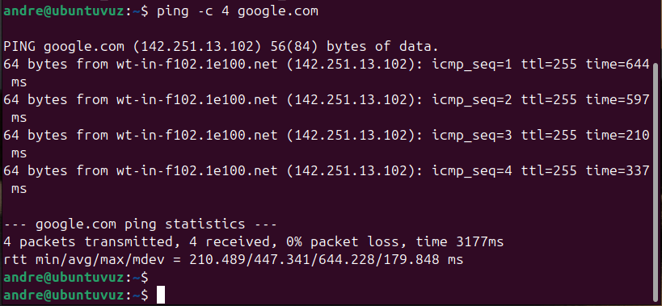

### 2. Настройка NAT и проброса порта

В настройках сети VirtualBox (тип подключения **NAT**) создано правило перенаправления TCP-порта для подключения с Windows:

| Имя | Протокол | Адрес хоста | Порт хоста | Адрес гостя | Порт гостя |
|---|---|---|---|---|---|
| SSH | TCP | `127.0.0.1` | `2222` | `10.0.2.15` | `22` |

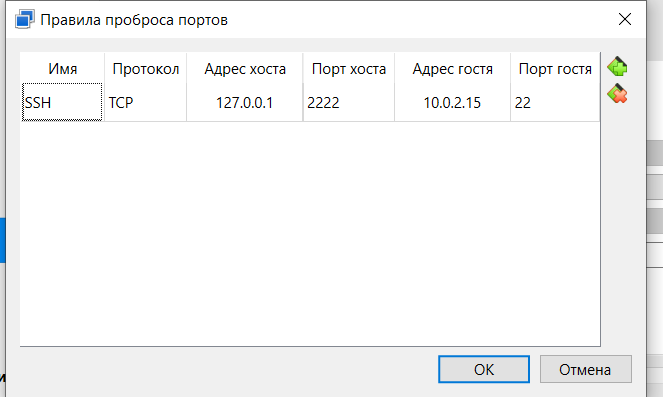

### 3. Установка и проверка SSH-сервера

В Ubuntu установлен `openssh-server`, служба включена в автозагрузку и запущена:

```bash
sudo apt install openssh-server
sudo systemctl enable --now ssh
sudo systemctl status ssh
```

Результат проверки: **`Active: active (running)`**, SSH-сервер слушает порт `22`.

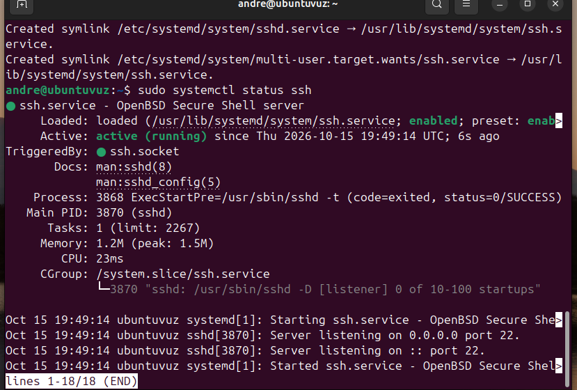

### 4. Создание пользователя runner

Создана группа и отдельный пользователь с домашним каталогом, оболочкой Bash и членством в группе `sudo`:

```bash
sudo addgroup runner
sudo useradd -m -g runner -G sudo -s /bin/bash runner
sudo passwd runner
id runner
ls -ld /home/runner
```

Вывод `id runner` подтвердил членство в группе `sudo`, а `ls` — наличие `/home/runner`.

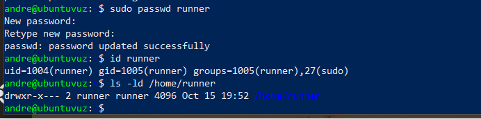

### 5. Проверка SSH-входа по паролю

С Windows через PowerShell проверен вход на виртуальную машину:

```powershell
ssh -p 2222 runner@127.0.0.1
```

После ввода пароля получено приглашение командной строки `runner@ubuntuvuz:~$`.

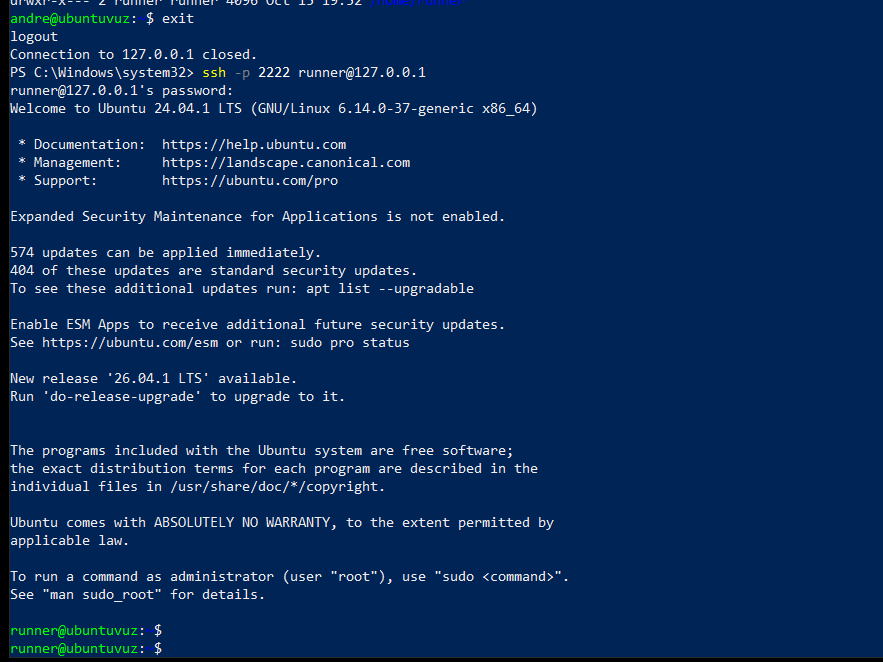

### 6. Настройка входа по SSH-ключу

На **Windows** сгенерирована пара ключей Ed25519:

```powershell
ssh-keygen -t ed25519 -C "devops-lab1"
```

Публичная часть ключа передана в файл `/home/runner/.ssh/authorized_keys` **по SSH-соединению**, как требуется в практической работе:

```powershell
Get-Content "$env:USERPROFILE\.ssh\id_ed25519.pub" | ssh -p 2222 runner@127.0.0.1 "umask 077; mkdir -p ~/.ssh; cat >> ~/.ssh/authorized_keys"
```

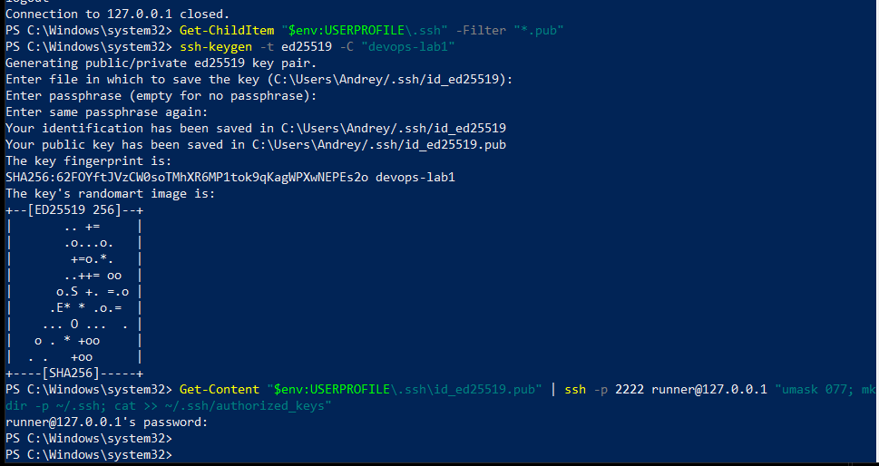

Затем выполнено подключение с указанием пути к приватному ключу на Windows:

```powershell
ssh -i "C:\Users\Andrey\.ssh\id_ed25519" -p 2222 runner@127.0.0.1
```

**Результат:** успешный вход под `runner` без запроса пароля пользователя Ubuntu. Для этого учебного ключа также не задавалась парольная фраза.

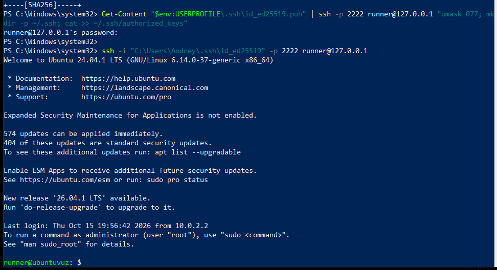

> **Безопасность:** приватный ключ `id_ed25519` не размещается в репозитории. Здесь приведён только пример его пути. В конфигурации учебной ВМ вход по ключу использован для демонстрации работы SSH.

### 7. Настройка sudo без пароля

Для пользователя `runner` создано правило в `/etc/sudoers.d/runner` через `visudo`:

```bash
sudo visudo -f /etc/sudoers.d/runner
```

Содержимое правила:

```text
runner ALL=(ALL:ALL) NOPASSWD:ALL
```

После повторного SSH-подключения выполнена проверка:

```bash
sudo -n whoami
```

Получен ответ **`root`** без запроса пароля.

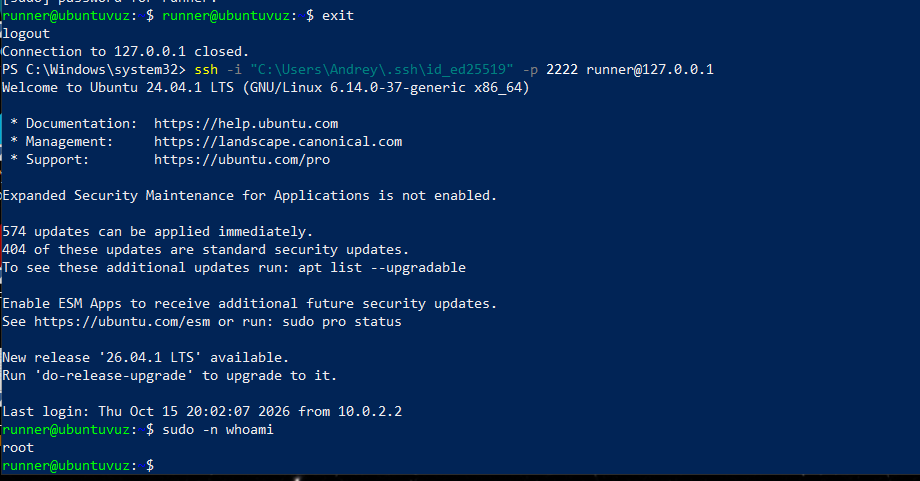

> Правило `NOPASSWD:ALL` применено только в учебной виртуальной машине по условию задания.

### 8. Подключение через VS Code Remote - SSH

На Windows установлен Visual Studio Code с расширением **Remote - SSH**. Для подключения добавлен SSH-профиль `ubuntu-devops`; пример настроек сохранён в [`configs/ssh_config.example`](configs/ssh_config.example).

Открыта папка `/home/runner` на Ubuntu. В удалённом терминале проверены:

```bash
whoami
pwd
hostname
```

Результаты: `runner`, `/home/runner`, `ubuntuvuz`. В левом нижнем углу VS Code отображается **`SSH: ubuntu-devops`**.

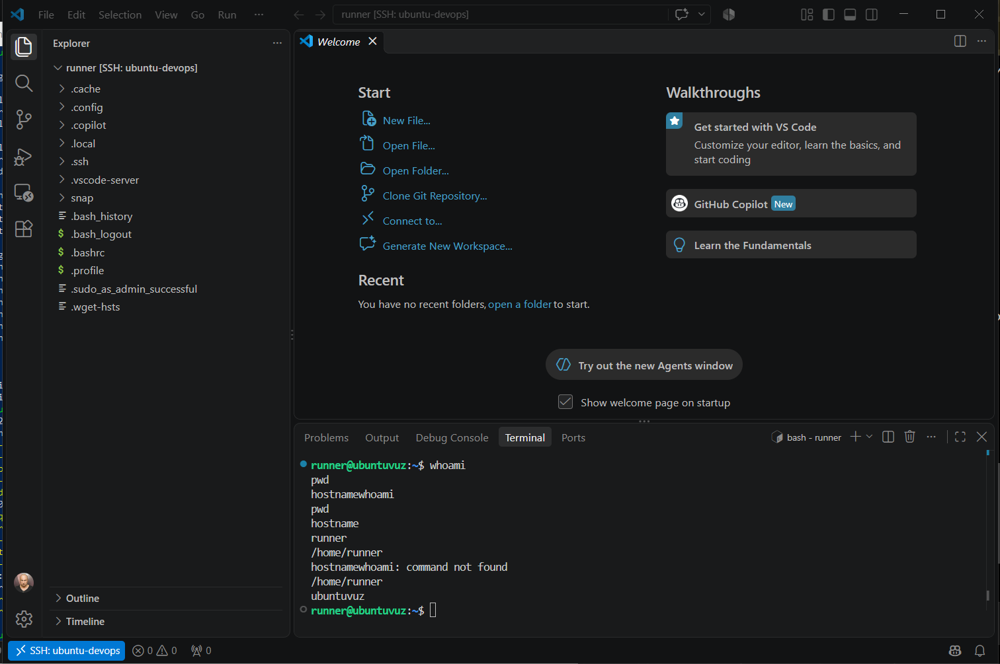

### 9. Диагностика Linux, файлов и дисков

В ходе практической работы выполнены диагностические команды:

```bash
uname -a
lsb_release -a
ls -la
lsblk
df -h
sudo fdisk -l
mount | head -n 10
top
```

Они использованы для просмотра версии ядра и ОС, файлов, дисков и разделов, смонтированных файловых систем и запущенных процессов.

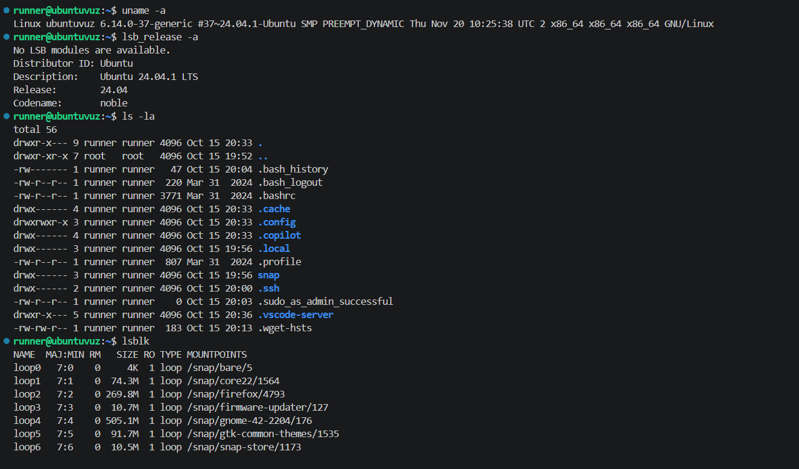

На тестовом файле `test_lab1.txt` проверены права доступа и изменение владельца:

```bash
touch test_lab1.txt
ls -l test_lab1.txt
chmod 600 test_lab1.txt
ls -l test_lab1.txt
sudo chown root:root test_lab1.txt
ls -l test_lab1.txt
sudo chown runner:runner test_lab1.txt
ls -l test_lab1.txt
```

В результате права изменились на `-rw-------`, владельцем временно стал `root`, после чего владелец был возвращён на `runner`.

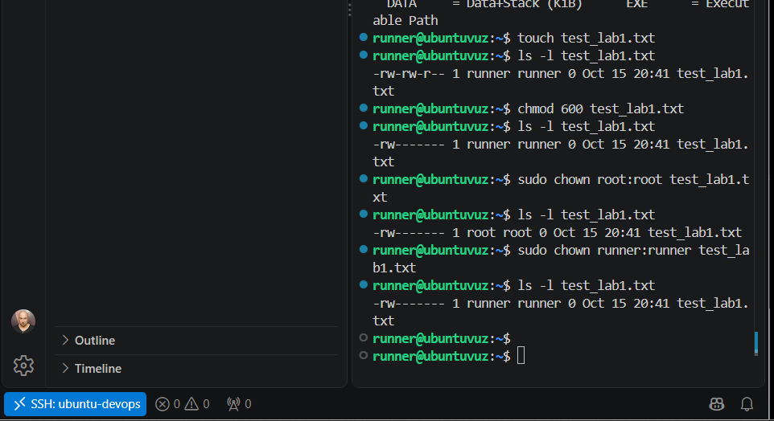

### 10. Диагностика сети и проверка программ

```bash
traceroute -m 8 google.com
python3 --version
git --version
```

Команда `traceroute` показала первый узел — шлюз VirtualBox `10.0.2.2`; последующие узлы не ответили (`* * *`). При этом отдельная проверка `ping` ранее подтвердила доступность внешней сети.

Проверено наличие **Python 3.12.3** и **Git 2.43.0**. Они уже были установлены в используемой Ubuntu.

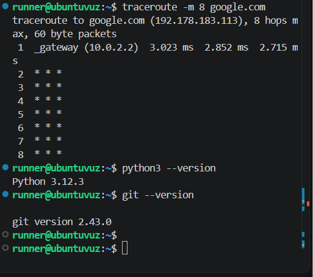

## Результат

Проверена работа Ubuntu в VirtualBox, настроен сетевой доступ по NAT и SSH-сервер, создан пользователь `runner` с домашним каталогом и правами `sudo`, настроена аутентификация по SSH-ключу с Windows и подтверждено подключение через VS Code Remote - SSH. Выполнены основные диагностические команды Linux, включая просмотр сетевых параметров, дисков, процессов и прав доступа.

## Состав репозитория

```text
devops_lab1/
├── README.md
├── configs/
│   ├── ssh_config.example
│   └── runner-sudoers.example
└── screenshots/
    ├── 01-ubuntu-network.png
    ├── 02-ping-google.png
    ├── 03-virtualbox-nat.png
    ├── 04-ssh-server.png
    ├── 05-ssh-password-login.png
    ├── 06-user-runner.png
    ├── 07-ssh-public-key-transfer.png
    ├── 08-ssh-key-login.png
    ├── 09-sudo-without-password.png
    ├── 10-vscode-remote-ssh.png
    ├── 11-linux-diagnostics.png
    ├── 12-chmod-chown.png
    └── 13-network-python-git.png
```

Файлы в `configs/` — примеры используемых настроек для воспроизведения лабораторной, а не экспорт приватных ключей или полная копия системных конфигураций. PNG-файлы — скриншоты фактически выполненных действий.
